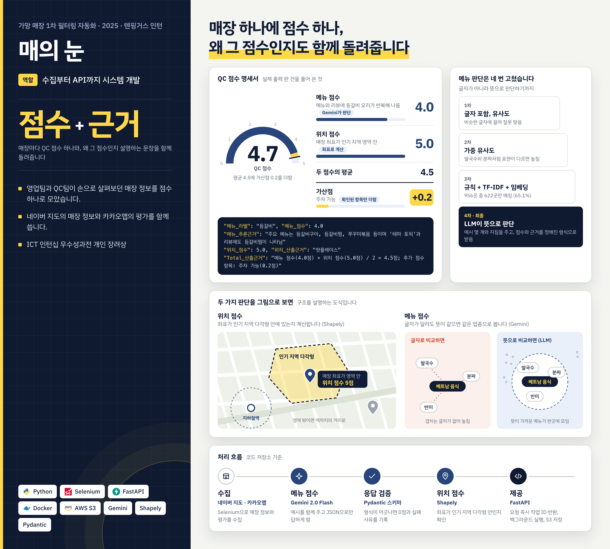
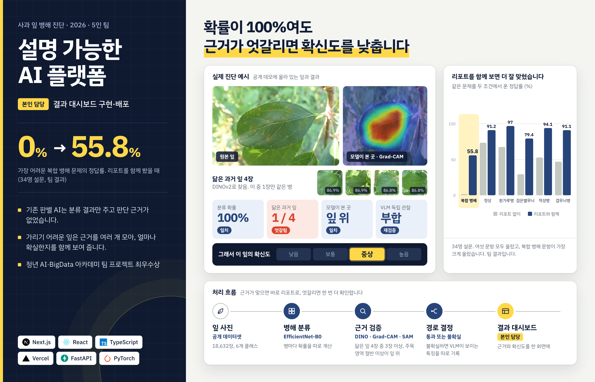
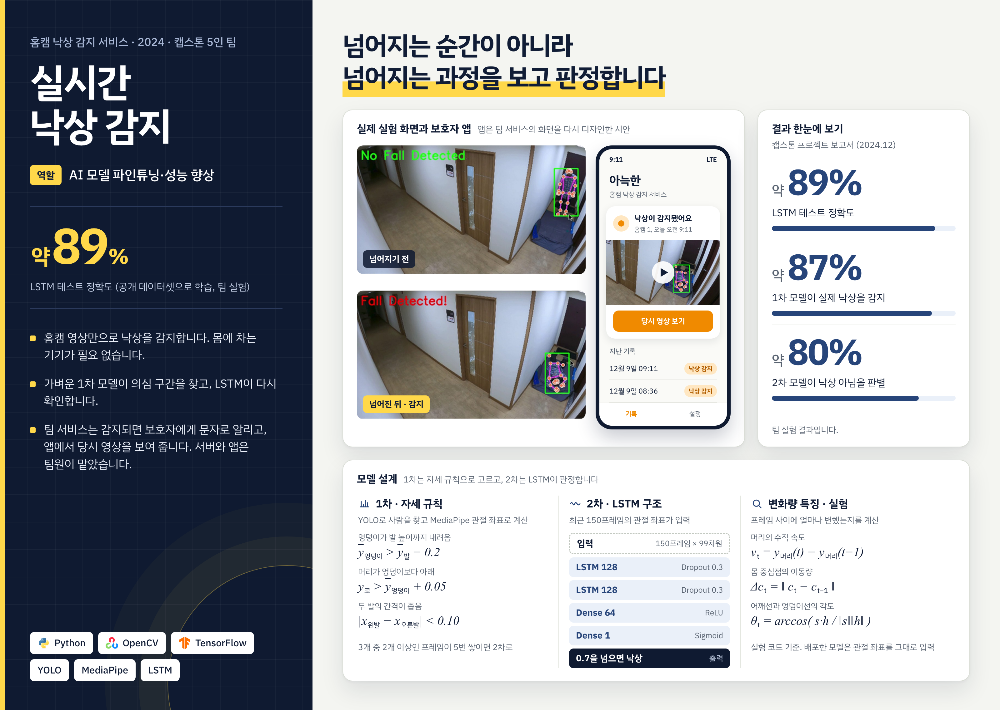
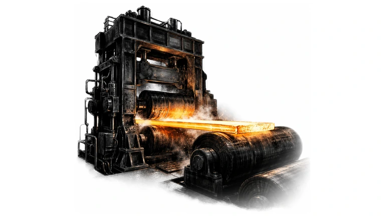
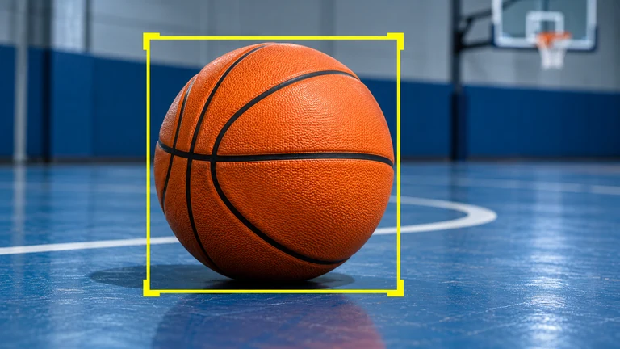
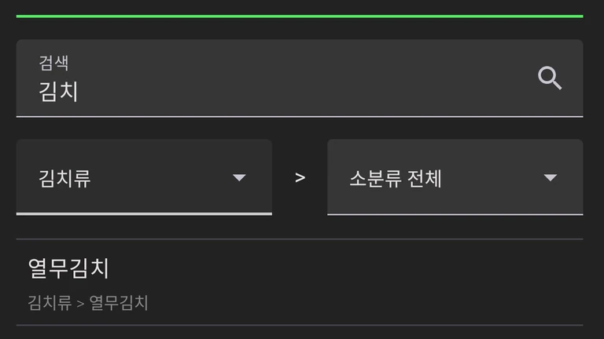
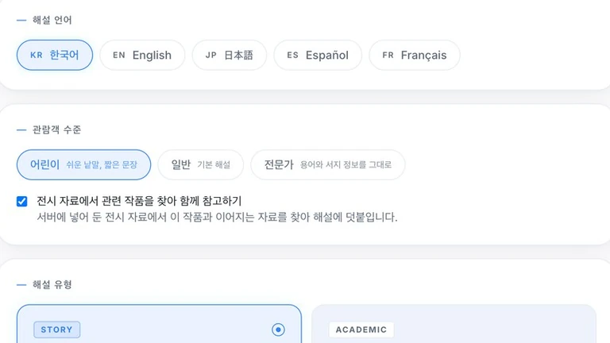

[사진 출처](https://svs.gsfc.nasa.gov/30561/) · NASA, ESA, J. Dalcanton (University of Washington), the PHAT team, and R. Gendler

# 기다슬 · Applied AI Engineer

**[POSTECH 인공지능연구원(PIAI)](https://piai.postech.ac.kr/)**

일상과 산업 현장에서 겪는 불편을 줄이기 위해 AI를 연구하고 개발합니다. AI 전환(AX) 관점에서 실제로 어떤 문제를 풀어야 하는지 살피고, AI가 문제 해결에 도움이 되는지 검증해 현장에서 쓸 수 있는 서비스로 구현합니다.

[이메일](mailto:hye0328@postech.ac.kr)

## 대표 프로젝트

### 매의 눈 · AI 기반 신규 매장 발굴

구현 설명 자세히 보기

- 텐핑거스 인턴으로 매장 데이터를 수집하고, XGBoost로 제휴 가능성을 예측해 결과를 API로 제공하는 기능을 개발했습니다.
- 메뉴와 리뷰를 바탕으로 LLM이 업종을 해석하도록 개선했습니다. ICT 학점연계 프로젝트 인턴십 우수성과전에서 개인 장려상을 받았습니다.

**설계 판단** · 제휴 가능성 점수와 업종 라벨을 따로 산출했습니다. 정형 특성의 점수 기여도는 SHAP으로 확인하고, LLM 출력은 허용된 업종 라벨로 제한했습니다.

[개발 사례 읽기](case-studies/eagle-eye.md)

### 사과 잎 병해 진단 · 설명 가능한 AI 플랫폼

구현 설명과 팀 설문 결과 보기

- 5인 팀에서 병해 진단 결과와 모델의 판단 근거를 보여주는 대시보드를 구현하고 배포했습니다.
- 청년 AI·BigData 아카데미 팀 프로젝트 최우수상을 받았습니다. 팀은 34명을 대상으로 리포트 평가 설문을 진행했습니다.

**팀 설계와 개인 기여** · 팀 파이프라인은 복합 병해나 근거가 엇갈리는 경우에 VLM으로 추가 관찰합니다. 제가 구현·배포한 부분은 결과 대시보드입니다.

Grad-CAM 보기

| 사과 잎 원본 | Grad-CAM 히트맵 |
| :---: | :---: |
|  |  |

[대시보드 구조와 진단 사례](case-studies/apple-orchard-xai.md) · [대시보드 데모](https://applecare-orchard.vercel.app/)

### 실시간 낙상 감지

구현 설명 자세히 보기

- RGB 영상에서 YOLO로 사람을 찾고, MediaPipe로 자세를 추정한 뒤 LSTM으로 낙상 여부를 판정했습니다.
- 카메라 처리와 LSTM 추론을 별도 프로세스로 나누고, 두 프로세스 사이에 대기 항목 하나를 담는 큐를 뒀습니다.

**설계 판단** · 엉덩이·발·코의 상대 위치로 의심 구간을 먼저 골라냅니다. 큐가 가득 차면 기존 대기 항목의 교체를 시도합니다. LSTM 워커는 관절 좌표 150개 시점이 갖춰졌을 때 추론합니다.

[처리 구조와 코드 읽기](case-studies/fall-detection.md) · [프로젝트 저장소](https://github.com/gidaseul/capstone_pose)

## 더 살펴볼 프로젝트

<table>
  <thead>
    <tr><th scope="col">미리보기</th><th scope="col">프로젝트</th></tr>
  </thead>
  <tbody>
    <tr>
      <td align="center"></td>
      <td><a href="case-studies/posco-steel-quality.md"><strong>후판 Scale 불량 예측</strong></a> 압연 공정에서 불량을 더 찾을 때 추가 검사가 얼마나 늘어나는지 비교했습니다.</td>
    </tr>
    <tr>
      <td align="center"></td>
      <td><a href="case-studies/card-fraud-detection.md"><strong>신용카드 사기 탐지</strong></a> 사기 비율이 약 0.14%인 교육 데이터에서 미탐과 오탐 비용으로 모델을 비교했습니다.</td>
    </tr>
    <tr>
      <td align="center"></td>
      <td><a href="case-studies/image-classification.md"><strong>이미지 분류와 표현학습</strong></a> 스포츠 공 사진에서 관심 영역을 잘못 잡았을 때 분류가 어떻게 실패하는지 분석했습니다.</td>
    </tr>
    <tr>
      <td align="center"></td>
      <td><a href="case-studies/babbogi.md"><strong>밥보기</strong></a> 검색 결과에서 고른 음식의 식품 코드로 중량에 맞는 영양정보를 조회합니다.</td>
    </tr>
    <tr>
      <td align="center"></td>
      <td><a href="case-studies/curiator.md"><strong>Curiator · 박물관 도슨트 AI</strong></a> 관람객에 맞는 해설을 만들고, 화면에서 수정한 문장을 음성으로 들려줍니다.</td>
    </tr>
  </tbody>
</table>

## 🛠 Languages & Tools

| 분야와 도구 | 적용한 곳 |
| --- | --- |
|    **영상·시계열** Python · OpenCV · YOLO · MediaPipe · TensorFlow/Keras | [실시간 낙상 감지](https://github.com/gidaseul/capstone_pose)에서 사람 검출과 자세 추정을 분리하고, 관절 시퀀스를 LSTM에 전달했습니다. |
|   **모델 학습·분석** PyTorch · scikit-learn · t-SNE | [이미지 분류와 표현학습](https://github.com/gidaseul/machine-learning-project)에서 Autoencoder와 대조학습을 실험하고, t-SNE로 두 데이터셋의 잠재 표현을 비교했습니다. |
|  **ML·LLM 응용** XGBoost · SHAP · Gemini | [매의 눈](case-studies/eagle-eye.md)에서 제휴 점수의 특성별 기여도를 설명하고, 메뉴와 리뷰를 바탕으로 업종을 분류했습니다. |
|    **API·데이터 처리** FastAPI · Docker · AWS S3 · Java/Spring Boot | [매의 눈](case-studies/eagle-eye.md)에서 수집기를 패키징하고 수집 결과를 저장해 API로 제공했습니다. [밥보기](case-studies/babbogi.md)에서는 음식 검색·상세 조회를 구현했습니다. |
|   **결과 시각화** Next.js · React | [사과 잎 병해 진단](https://applecare-orchard.vercel.app/)에서 팀 모델의 분류 결과, Grad-CAM, 진단 리포트를 보여주는 대시보드를 구현·배포했습니다. |

## Career Path

- **현재** · [POSTECH 인공지능연구원(PIAI)](https://piai.postech.ac.kr/english) 연구원
- **2026** · POSTECH 인공지능연구원 연구인턴 (8–9월). 산업 현장 낙상 감지 파이프라인의 단계별 오류를 분석하고, 소형 VLM 기반 판정으로 바꾸는 실험을 했습니다.
- **2026** · 청년 AI·BigData 아카데미 33기 수료 (5–7월). 병해 진단 XAI 플랫폼과 후판 품질 예측 팀 프로젝트에 참여했습니다. 팀으로 프로젝트 최우수상을 받았고, 개인으로 우수상과 협력상을 받았습니다.
- **2025** · 텐핑거스 ICT 학점연계 프로젝트 인턴 (3–6월). 신규 제휴 매장 발굴 시스템을 개발했고, 우수성과전에서 개인 장려상을 받았습니다.
- **2024–2025** · 숭실대 Vision & Machine Learning Lab 학부연구생. PointNet++ 기반 치아 3D 분할을 재현하고, CT 골밀도 데이터를 전처리했습니다.
- **2021–2022** · Syncorbis 창업팀 Bio & SW Engineer. 생명과학 실험 자동화 장치를 설계했고, [특허](https://doi.org/10.8080/1020210123255)에 공동발명자로 등록됐습니다.

<b>Awards · Education · Activities</b>

 

**AWARDS**
- **2026** · 청년 AI·BigData 아카데미 33기 프로젝트 최우수상(팀) · 우수상 · 협력상
- **2025** · ICT 학점연계 프로젝트 인턴십 우수성과전 개인 장려상
- **2024** · 숭실대 IT대학 소프트웨어 공모전 은상(팀, 밥보기) · SCON 4th Place(팀)
- **2021–2025** · 전라남도 으뜸인재
- **2019** · 대한민국 인재상 (부총리 겸 교육부장관상) · [기사](https://www.dmorning.kr/news/articleView.html?idxno=41872)

**EDUCATION & CERTIFICATION**
- **2020–2026** · 숭실대학교 AI소프트웨어학부 인공지능·빅데이터 전공 졸업
- **2026** · SSAFY 15기 합격 (서울)
- **2025** · LG Aimers 7기 수료 (수요 예측 해커톤)
- **2022** · SQLD

**ACTIVITIES**
- **2025–2026** · GDG on Campus Soongsil 5기 Member
- **2025** · Curiator 캡스톤 프로젝트 (4학년 2학기), 관람객 맞춤형 AI 도슨트 프로토타입

소개 영상 보기

  

## 👯 Communities

<table>
<tr>
<td align="center" width="33%">
 
<a href="https://www.boostcourse.org">부스트코스 DATA SCIENCE 코칭스터디 수료</a>
</td>
<td align="center" width="33%">
 
<a href="https://fastcampus.co.kr/">MLOps : 추천 시스템 구축부터 최적화까지</a>
</td>
<td align="center" width="33%">
 
<a href="https://lgaimers.ai/">LG Aimers 7기 수료</a>
</td>
</tr>
</table>

## 🧠 Algorithm Solutions

자동 집계되는 [Algorithm-Solutions](https://github.com/gidaseul/Algorithm-Solutions) 레포와 연결 (GitHub Actions 자동 동기화).

  

  

  
플랫폼별 진행 더 보기

   
  

      
      
      
    
  

