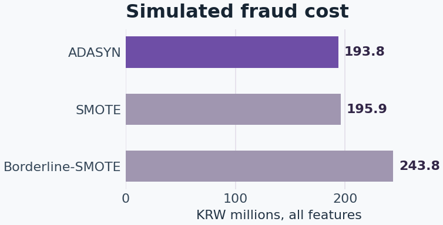

# 신용카드 사기 탐지 · 불균형 데이터에서 비용으로 모델 선택

숭실대학교 데이터사이언스 수업 · 2024년 2학기 · 4인 팀 프로젝트

## 목차

1. [문제와 담당 범위](#문제와-담당-범위)
1. [실험 코드 읽는 순서](#실험-코드-읽는-순서)
1. [실험 설계](#실험-설계)
1. [거래별 판정을 비용으로 환산](#거래별-판정을-비용으로-환산)
1. [동일한 정확도에서도 비용이 달라지는 예시](#동일한-정확도에서도-비용이-달라지는-예시)
1. [비용 비교 결과](#비용-비교-결과)
1. [해석과 재검증](#해석과-재검증)

## 문제와 담당 범위

교육용 카드 거래 데이터 1,644,768건 중 사기 거래는 2,321건(약 0.14%)이었습니다. 모든 거래를 정상으로 분류해도 정확도는 약 99.86%이므로 사기 탐지 능력을 판단하기 어렵습니다. 팀은 사기 미탐으로 발생하는 손실과 정상 거래 오탐으로 드는 조사 비용을 함께 고려했습니다.

팀장으로 실험 비교 조건을 정리하고, 특성 선택·샘플링·모델 조합을 실행해 분류 리포트와 혼동 행렬을 저장하는 Python 스크립트를 작성했습니다. 아래 비용 비교는 팀이 최종 보고서에 정리한 결과입니다.

## 실험 코드 읽는 순서

```text
Automation.py
├── main()                              특성·샘플링·모델 후보 순회
└── run_experiment()                    조건 하나의 전처리, 학습과 평가
    ├── encode_and_transform_dates()    범주와 거래 시각 변환
    ├── 샘플링 함수                     소수 클래스와 다수 클래스 비율 조정
    └── 혼동행렬·분류 리포트 출력        후보별 오탐과 미탐 확인

팀 최종 보고서
└── 보관한 평가 세트에서 후보 재비교 → 비용표
```

자동화 스크립트의 출력은 분류 지표와 혼동행렬입니다. 비용표는 팀이 보관한 평가 세트에 후보를 적용한 뒤, 놓친 거래 금액과 잘못 표시한 거래의 조사 비용을 별도로 합산한 결과입니다.

## 실험 설계

| 비교 축 | 실험 조건 |
|---|---|
| 입력 특성 2가지 | 전체 특성 사용 또는 선택된 특성 사용. 단일 특성을 제거했을 때의 성능 변화와 트리·선형 모델의 중요도를 참고해 후보를 정했습니다. |
| 샘플링 6가지 | 미적용, 무작위 오버샘플링, 무작위 언더샘플링, SMOTE, Borderline-SMOTE, ADASYN |
| 모델 12가지 | 로지스틱 회귀, 클래스 가중치를 적용한 랜덤 포레스트, 결정 트리, SVM, Isolation Forest, LOF, SGD 분류기, Gradient Boosting, CatBoost, AdaBoost, XGBoost, Gaussian Naive Bayes |

이렇게 **144개 후보 조건**을 설계했습니다. 초기 탐색에서 랜덤 포레스트와 결정 트리 계열을 추렸고, SVM은 계산 시간 문제로 일부 결과를 얻지 못했습니다.

첫 실험에서 한 후보 조건을 실행할 때는 범주형 정보를 수치로 바꾸고 거래 시각을 변환한 뒤, 선택한 샘플링 방법을 적용했습니다. 이어서 학습과 평가를 실행하고 조건별 분류 리포트와 혼동행렬을 남겼습니다. 이 구조로 어느 특성과 샘플링을 사용했을 때 나온 결과인지 기록할 수 있었고, 비용 비교 단계에서는 먼저 추린 후보를 같은 거래 집합에서 다시 평가했습니다.

초기 자동화 스크립트는 전처리와 리샘플링 후 데이터를 학습용과 평가용으로 나눴습니다. 이 방식은 합성에 사용된 관측값이 학습·평가에 걸칠 수 있고, 샘플링별 평가 건수와 사기 비율도 달라집니다. 팀은 비용을 비교할 때 샘플링 전에 따로 보관한 평가 세트에 후보 모델을 적용했습니다. 당시 코드에서 `BRF`라는 이름은 `RandomForestClassifier(class_weight="balanced")`를 가리킵니다.

## 거래별 판정을 비용으로 환산

혼동행렬에서 미탐은 걸러 내지 못한 사기 거래이고, 오탐은 조사 대상으로 잘못 표시한 정상 거래입니다. 팀은 미탐 건수만 세면 작은 거래와 큰 거래에 같은 가중치가 붙는다는 점을 고려해 실제 거래 금액을 비용 산식에 넣었습니다.

| 비용 항목 | 수업에서 사용한 가정 |
|---|---|
| 사기 미탐 | 놓친 사기 거래 금액의 100% |
| 정상 오탐 | 잘못 표시한 거래당 5,000원과 해당 거래 금액의 0.1% |
| 모델 운영 | 평가한 거래당 100원 |

세 항목의 합을 후보별로 계산했습니다. 평가 건수가 같다면 건당 운영 비용은 모든 후보에 공통입니다. 이때 모델 간 비용 차이는 놓친 사기 금액과 정상 거래 조사 비용에서 생깁니다.

## 동일한 정확도에서도 비용이 달라지는 예시

팀이 사용한 단가를 가상의 거래에 적용해 보겠습니다. 두 후보가 같은 100건을 판정해 각각 두 건을 틀렸다고 가정합니다. 후보 A는 10만 원 사기 거래 한 건을 놓치고, 2만 원 정상 거래 한 건을 잘못 표시했습니다. 후보 B는 사기를 모두 찾아냈고, 각각 2만 원인 정상 거래 두 건을 잘못 표시했습니다.

| 비용 구성 | 후보 A | 후보 B |
| --- | ---: | ---: |
| 사기 미탐 | 100,000원 | 0원 |
| 정상 거래 오탐 | 5,020원 | 10,040원 |
| 평가 100건의 운영 비용 | 10,000원 | 10,000원 |
| 총비용 | **115,020원** | **20,040원** |

두 후보의 정확도는 98%로 같지만 비용은 다릅니다. 이 예시에서는 정상 거래 조사 한 건을 더 하는 비용이 놓친 사기 거래 금액보다 작습니다. 실제 실험에서도 오류 건수에 거래 금액을 결합한 이유입니다.

## 비용 비교 결과

팀 보고서의 최종 비용표에서 클래스 가중 랜덤 포레스트와 합성 샘플링을 결합한 아래 여섯 조건을 비교했습니다.

| 샘플링 | 특성 선택 적용 | 전체 특성 사용 |
|---|---:|---:|
| SMOTE | 648,238,600원 | 195,910,600원 |
| Borderline-SMOTE | 555,578,600원 | 243,832,600원 |
| ADASYN | 629,215,500원 | **193,766,100원** |

비용표의 여섯 조건 중 **전체 특성 + ADASYN**이 가장 낮았습니다. 같은 전체 특성을 사용한 SMOTE와의 차이는 2,144,500원, 약 1.1%였습니다. 비교 조건을 고정한 결과이므로, 조사 단가나 사기 거래 금액의 분포가 달라지면 순위도 다시 확인해야 합니다.

샘플링 세 방식 모두 이 비용표에서는 전체 특성을 쓴 후보의 비용이 더 낮았습니다. 이 관찰을 특성 선택 전체에 일반화하려면 선택 과정과 평가를 시간상 분리해 다시 비교해야 합니다. 특히 ADASYN과 SMOTE는 최종 비용 차이가 작았으므로, 재평가에서는 총액과 함께 놓친 거래 금액의 분포 및 하루 조사 대상 건수를 기록하는 편이 실제 의사결정에 도움이 됩니다.



## 해석과 재검증

- 비용은 교육용 데이터와 위 단가를 적용한 모의 계산입니다. 실제 손실 절감액, 운영 효과, 통계적 유의성을 측정하지 않았습니다.
- 후보 비교에 평가 세트를 사용했고, 초기 코드에는 분할 전 전처리와 샘플링이 있습니다. 재검증에서는 거래 시점을 기준으로 학습·검증·최종 평가를 먼저 나누고, 인코더·스케일러·리샘플러는 학습 데이터에만 맞추겠습니다. 검증에서 임곗값을 정한 뒤 최종 평가에서 비용과 함께 정밀도·재현율 및 PR-AUC를 확인하는 편이 적절합니다.
- 결제 서비스에서 적용하려면 조사 수용량과 정상 거래 마찰 비용을 다시 정의하고, 비용의 단가를 바꿨을 때도 모델 순위가 유지되는지 확인해야 합니다.

**근거** · 데이터사이언스 수업 팀 최종 보고서의 실험 절차와 비용표, 당시 Python 실험 자동화 코드.

[프로필의 더 살펴볼 프로젝트로 돌아가기](../README.md#더-살펴볼-프로젝트)
