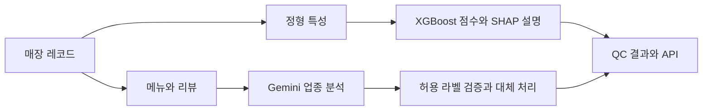

# 매의 눈 — AI 기반 잠재 매장 발굴 시스템

> 텐핑거스(데이트팝) AI 개발 인턴십 · 2025.03–2025.06  
> 회사 코드와 원천 데이터는 공개하지 않으며, 이 문서는 공개 가능한 문제 해결 과정만 설명합니다.

## 목차

1. [영업팀이 겪던 문제](#영업팀이-겪던-문제)
1. [맡은 범위](#맡은-범위)
1. [시스템 구성](#시스템-구성)
1. [수집부터 후보 점수까지](#수집부터-후보-점수까지)
1. [메뉴와 리뷰로 업종 분류](#메뉴와-리뷰로-업종-분류)
1. [결과 제공과 검증 범위](#결과-제공과-검증-범위)
1. [후보 매장 한 건을 검토하는 예시](#후보-매장-한-건을-검토하는-예시)
1. [공개 근거와 평가 한계](#공개-근거와-평가-한계)

## 영업팀이 겪던 문제

영업팀은 전국의 신규 매장을 직접 검색하고 스프레드시트로 가망 고객을 관리했습니다. 담당자의 경험에 따라 평가 기준이 달라졌고, 신규·폐업 매장을 빠르게 반영하거나 제휴 가능성을 일관된 기준으로 비교하기 어려웠습니다.

## 맡은 범위

AI 개발 인턴으로서 기획, 데이터 수집, 모델·LLM 실험, API와 자동화 환경 구성까지 개발을 담당했습니다. 영업팀·QC Center·AI 콘텐츠팀과는 영업 담당자가 후보 매장을 어떻게 검토하고 업종을 구분하는지 확인해 그 기준을 파이프라인에 반영했습니다.

## 시스템 구성

```text
신규 매장 발굴 파이프라인
├── 수집               네이버 매장과 카카오 평점 병합, 수집 상태 기록
├── 후보 평가          정형 특성에서 제휴 가능성 점수 계산
├── 업종 분류          메뉴·리뷰로 업종 추정, 허용 라벨 검증과 대체 처리
└── 결과 제공          QC 점수와 근거 정리, S3 저장과 API 조회
```

정형 점수는 영업 후보를 비교하는 데 쓰고, 업종 분류는 메뉴·리뷰가 필요한 별도 판단으로 뒀습니다. 수집에 실패한 레코드는 상태를 보존해 이후 처리에서 원인을 확인할 수 있게 했습니다. 위 트리는 비공개 코드의 파일명이 아닌 공개 가능한 모듈 구성을 나타냅니다.



## 수집부터 후보 점수까지

### 1. 반복 가능한 데이터 수집

- Selenium 기반 네이버맵 수집기 구현
- 네이버 사용자 편향을 보완하기 위해 카카오맵 평가 데이터 병합
- 수집 실패 데이터를 삭제하지 않고 상태값으로 보존
- Docker 패키징, AWS S3 업로드, Raspberry Pi 정기 실행 환경 구성
- 브라우저 드라이버 충돌 시 Firefox 전환과 멀티스레딩 적용

매장 정보와 수집 상태를 함께 보존했습니다. 담당자는 누락된 정보를 해석할 때, 처음부터 값이 없던 레코드와 수집이 실패한 레코드를 구분할 수 있습니다. S3 저장과 API 조회를 연결해 수집 결과를 이후 평가 단계에 전달했습니다.

두 지도 서비스의 평점은 제공되는 범위와 이용자가 다를 수 있습니다. 여러 출처를 한 레코드에 연결하면 후보를 더 다양한 근거로 살필 수 있지만, 한쪽 결과가 수집되지 않은 경우에는 상태를 함께 볼 필요가 있습니다. 예를 들어 평점 조회에 실패한 매장을 영업 후보에서 곧바로 제외하면 수집 장애가 후보 선별에 영향을 줄 수 있습니다. 평가 입력과 수집 상태를 함께 보존한 이유입니다.

### 2. 유사도 중심 접근의 한계 확인

Autoencoder와 코사인 유사도 방식은 기존 제휴 매장과 비슷한 곳을 찾는 데는 유용했지만, 새로운 유형의 후보를 발굴하는 목적에는 한계가 있었습니다. 이에 문제를 다음 세 단계로 분리했습니다.

1. XGBoost 기반 인기도 예측
2. SBERT와 정형 feature를 결합한 후보 표현 실험
3. XGBoost 기반 제휴 가능성 분류

1,149건의 불균형 데이터에는 Borderline-SMOTE, class weight, Stratified 5-Fold를 비교하고, 실제 영업 검수 비용을 고려해 Precision 중심 임계값을 검토했습니다.

제휴 점수의 목적은 후보를 정렬하는 것입니다. 같은 점수라도 어떤 정형 특성이 점수를 높이거나 낮췄는지 SHAP으로 확인할 수 있도록 구성했습니다. 매장 업종처럼 메뉴와 리뷰의 문맥이 필요한 판단은 별도 단계에 맡겼습니다.

유사도 방식에서는 기존 제휴 매장과 얼마나 닮았는지가 결과를 좌우합니다. 이 기준에서는 기존 목록에 드문 유형이 낮은 순위에 놓일 수 있습니다. 제휴 가능성 분류로 전환하면서 모델의 목적을 기존 매장과의 유사성에서 제휴 후보를 선별하는 문제로 바꿨습니다. 영업팀이 하루에 확인할 수 있는 후보 수가 한정돼 있다면, 전체 후보의 정확도와 함께 상위 후보 중 실제 검토 대상이 차지하는 비율을 볼 필요가 있습니다.

## 메뉴와 리뷰로 업종 분류

문자열과 유사도만으로 매장 카테고리를 분류할 때 동의어, 복합 업종, 메뉴·리뷰 맥락을 처리하기 어려웠습니다. 이후 Gemini API를 사용한 고정 레이블 의미 분류로 전환하고 다음 안전장치를 추가했습니다.

- 허용된 레이블만 반환하도록 출력 제약
- 응답 파싱과 fallback
- 배치 처리와 캐싱
- QC Center의 검수 기준을 QC Score와 프롬프트에 반영

허용 라벨 목록이 있어야 기존 영업 데이터에서 결과를 같은 기준으로 검색하거나 집계할 수 있습니다. 응답을 파싱한 뒤 그 목록과 대조하고, 형식이 어긋나면 대체 처리를 거치도록 했습니다.

## 결과 제공과 검증 범위

수집, ML·LLM 추론, QC 결과 저장과 API 조회를 연결한 파이프라인을 구현했습니다. 검토 흐름에서 각 항목이 하는 역할은 다음과 같습니다.

| 결과 | 읽는 방법 |
| --- | --- |
| 제휴 가능성 점수 | 후보 우선순위를 정할 때 사용합니다. |
| SHAP 설명 | 정형 특성이 점수에 기여한 방향을 살펴봅니다. |
| 업종 라벨 | 메뉴와 리뷰에서 얻은 업종 판단을 허용 라벨로 정리합니다. |
| 수집 상태 | 원천 정보가 누락된 후보를 다시 확인할 때 사용합니다. |

## 후보 매장 한 건을 검토하는 예시

규칙을 읽기 위한 가상 사례로, 커피와 디저트를 함께 제공하는 매장이 상위 후보에 올랐다고 가정해 보겠습니다. 제휴 점수는 먼저 확인할 매장인지 판단하는 데 쓰입니다. SHAP은 그 매장의 점수를 구성한 정형 특성 중 어떤 항목이 점수를 올리거나 내렸는지 보여줍니다. 여기서 얻는 것은 모델의 점수 설명이며 매장을 제휴 대상으로 확정하는 것은 별도 판단입니다.

다음으로 업종을 확인합니다. 메뉴와 리뷰에 여러 업종 이름이 등장해도 검수자는 같은 분류표에서 후보를 찾아야 합니다. 모델의 응답을 허용 라벨과 대조하고, 형식이 맞지 않을 때는 별도 처리 경로로 넘깁니다. 수집 상태까지 보면 업종 판단에 필요한 메뉴나 리뷰가 빠져 있는지, 자료를 다시 확인할지를 결정할 수 있습니다.

이처럼 순위, 점수에 대한 설명, 업종 라벨, 수집 상태를 한 후보에 묶으면 검토 과정에서 생긴 이견을 추적할 수 있습니다. 후보가 검토 대상과 맞지 않았는지, 업종이 틀렸는지, 원문이 부족했는지를 구분하면 다시 확인할 파이프라인 단계도 정해집니다.

## 공개 근거와 평가 한계

### 확인된 자료

- 인턴십 수행확인서와 종합보고서
- `datepop/eagle-eye` Git 이력의 개발 커밋
- 크롤링, QC Score, FastAPI, Docker 관련 코드
- 개발 전 과정 단독 수행에 대한 본인 확인

### 공개하지 않는 자료

- 회사 소유 소스코드
- 원천 매장 데이터와 내부 영업 기준
- API 키, 스토리지 정보, 운영 환경 설정
- 내부 보고서 원문

업종 분류 개선 폭을 공개 수치로 평가하려면 같은 표본에 두 방식을 적용하고, 매장별 기준 라벨을 누가 어떤 기준으로 판정했는지 정리해야 합니다. 후보 평가를 검증할 때는 영업 검수 인원에 맞춰 상위 후보를 고른 다음, 실제 검토 대상과 맞는 비율을 확인하는 방식이 적합합니다. 운영 전환율과 비용 절감 효과는 별도 측정이 필요합니다.

| 다시 평가할 부분 | 확인할 자료 |
| --- | --- |
| 후보 순위 | 앞부분에 제시한 매장 중 검수자가 실제 검토 대상으로 판정한 비율 |
| 업종 분류 | 같은 매장에 적용한 기존 분류와 LLM 분류, 검수 기준 라벨, 업종별 오분류 |
| 수집·제공 자동화 | 수집 실패 비율, 다시 수집했을 때 회복된 건수, 조회까지 걸린 시간 |

[프로필의 대표 프로젝트로 돌아가기](../README.md#대표-프로젝트)
