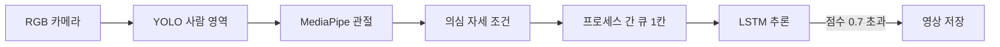

# 실시간 낙상 감지

숭실대 캡스톤 프로젝트. RGB 카메라에서 사람과 관절을 추정하고, 의심 구간만 시계열 모델에 전달하도록 파이프라인을 구성했습니다. [공개 코드](https://github.com/gidaseul/capstone_pose)



## 처리 흐름

```text
main.py
└── Pipeline                   카메라 워커와 추론 워커 연결
    ├── process/CameraProcess.py  YOLO 사람 검출, MediaPipe 관절, 자세 규칙
    ├── PipedProcess.py          대기 항목 한 개를 담는 프로세스 간 큐
    └── process/LSTMProcess.py    관절 시퀀스 추론, 감지 영상 저장
        └── lstm_fall_detection_model.h5
```

1. 카메라 워커가 YOLO로 사람 영역을 찾고 MediaPipe로 관절 위치를 추정합니다. 엉덩이·발·코의 상대 위치로 낙상 의심 자세를 고릅니다. [카메라 워커](https://github.com/gidaseul/capstone_pose/blob/49a0ad8620eb1c05e7e772ec47ac1bfca14539e9/process/CameraProcess.py#L31-L126)
2. 카메라와 LSTM을 분리해 추론을 기다리는 동안에도 카메라 워커가 진행할 수 있게 했습니다. 큐가 차면 대기 항목을 새 항목으로 교체하려고 시도합니다. [큐와 워커 연결](https://github.com/gidaseul/capstone_pose/blob/49a0ad8620eb1c05e7e772ec47ac1bfca14539e9/PipedProcess.py#L12-L45)
3. 150개 시점의 관절 좌표가 쌓이면 LSTM 워커가 `(1, 150, 99)` 입력으로 추론합니다. 점수가 0.7을 넘으면 수집한 프레임을 영상으로 저장합니다. [LSTM 추론과 저장](https://github.com/gidaseul/capstone_pose/blob/49a0ad8620eb1c05e7e772ec47ac1bfca14539e9/process/LSTMProcess.py#L19-L69)

## 재현할 때 확인할 조건

실행 진입점 `main.py`는 카메라, YOLO 가중치와 LSTM 체크포인트 경로를 지정합니다. 이 구현의 자세 규칙과 0.7 임계값은 캡스톤 설정입니다. 실제 현장에서의 검출률을 보려면 카메라 배치, 몸 일부가 가려지는 상황, 작업 중 몸을 낮추는 자세를 별도로 평가해야 합니다. [실행 진입점](https://github.com/gidaseul/capstone_pose/blob/49a0ad8620eb1c05e7e772ec47ac1bfca14539e9/main.py)

[프로필의 대표 프로젝트로 돌아가기](../README.md#대표-프로젝트)
