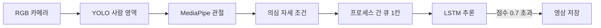

# 실시간 낙상 감지

숭실대 캡스톤 프로젝트. RGB 카메라에서 사람과 관절을 추정하고, 의심 구간만 시계열 모델에 전달하도록 파이프라인을 구성했습니다. [공개 코드](https://github.com/gidaseul/capstone_pose)

## 목차

1. [문제와 목표](#문제와-목표)
1. [처리 흐름](#처리-흐름)
1. [왜 자세 규칙과 시계열 모델을 함께 썼나](#왜-자세-규칙과-시계열-모델을-함께-썼나)
1. [판정과 영상 저장](#판정과-영상-저장)
1. [재현할 때 확인할 조건](#재현할-때-확인할-조건)

## 문제와 목표

사람이 몸을 낮춘 한 프레임만으로는 실제로 넘어지는 중인지 구분하기 어렵습니다. 자세 규칙으로 의심 구간을 고르고, 그 시점까지 모은 관절 움직임을 시계열 입력으로 전달해 낙상 여부를 판정했습니다. 카메라 처리와 LSTM 추론은 각각의 프로세스에서 동작합니다.

## 처리 흐름



```text
main.py
└── Pipeline                   카메라 워커와 추론 워커 연결
    ├── process/CameraProcess.py  YOLO 사람 검출, MediaPipe 관절, 자세 규칙
    ├── PipedProcess.py          대기 항목 한 개를 담는 프로세스 간 큐
    └── process/LSTMProcess.py    관절 시퀀스 추론, 감지 영상 저장
        └── lstm_fall_detection_model.h5
```

1. 카메라 워커가 YOLO로 사람 영역을 찾고 MediaPipe로 관절 위치를 추정합니다. 엉덩이·발·코의 상대 위치로 낙상 의심 자세를 고릅니다. [카메라 워커](https://github.com/gidaseul/capstone_pose/blob/49a0ad8620eb1c05e7e772ec47ac1bfca14539e9/process/CameraProcess.py#L31-L126)
2. 카메라와 LSTM을 분리해 추론을 기다리는 동안에도 카메라 워커가 진행할 수 있게 했습니다. 큐가 차면 대기 항목을 새 항목으로 교체하려고 시도합니다. [큐와 워커 연결](https://github.com/gidaseul/capstone_pose/blob/49a0ad8620eb1c05e7e772ec47ac1bfca14539e9/PipedProcess.py#L12-L45)
3. 150개 시점의 관절 좌표가 쌓이면 LSTM 워커가 `(1, 150, 99)` 입력으로 추론합니다. 점수가 0.7을 넘으면 수집한 프레임을 영상으로 저장합니다. [LSTM 추론과 저장](https://github.com/gidaseul/capstone_pose/blob/49a0ad8620eb1c05e7e772ec47ac1bfca14539e9/process/LSTMProcess.py#L19-L69)

## 왜 자세 규칙과 시계열 모델을 함께 썼나

자세 규칙은 LSTM에 넘길 구간을 고르는 역할입니다. 한 시점에 관절 33개의 x·y·z 값을 펴서 99개 수치로 저장하고, 최근 150개 시점을 모아 움직임을 표현합니다. 공개 구현은 관절을 얻지 못한 시점에 기본값을 기록하므로 가려짐이 길어지면 시퀀스의 품질이 달라질 수 있습니다.

프로세스 간 대기열은 한 항목만 보관합니다. 추론이 느릴 때 오래된 후보가 계속 쌓이는 것을 줄이기 위한 구조이며, 교체 과정에서 대기 중이던 후보가 빠질 수 있습니다. 지연 시간과 후보 손실 여부를 함께 보는 이유입니다.

## 판정과 영상 저장

| 상황 | 구현 동작 |
| --- | --- |
| 150개 시점이 아직 모이지 않음 | LSTM 추론을 건너뜁니다. |
| 낙상 점수가 0.7 초과 | 모아 둔 RGB 프레임을 타임스탬프가 붙은 MP4로 저장합니다. |
| 영상 저장 직후 | 추론 워커가 30초 대기합니다. 이 시간에 들어온 다음 후보는 즉시 판정하지 못합니다. |

## 재현할 때 확인할 조건

실행 진입점 `main.py`는 카메라, YOLO 가중치와 LSTM 체크포인트 경로를 지정합니다. 이 구현의 자세 규칙과 0.7 임계값은 캡스톤 설정입니다. 실제 현장에서의 검출률을 보려면 카메라 배치, 몸 일부가 가려지는 상황, 작업 중 몸을 낮추는 자세를 별도로 평가해야 합니다. [실행 진입점](https://github.com/gidaseul/capstone_pose/blob/49a0ad8620eb1c05e7e772ec47ac1bfca14539e9/main.py)

재현할 때는 영상별 정답 구간과 저장 시점을 대조해 낙상 미탐, 반복 경보, 이벤트부터 저장까지의 지연을 기록할 수 있습니다. 카메라 높이나 관찰 범위를 바꿀 때는 같은 영상 세트에서 결과를 비교하는 것이 중요합니다.

[프로필의 대표 프로젝트로 돌아가기](../README.md#대표-프로젝트)
