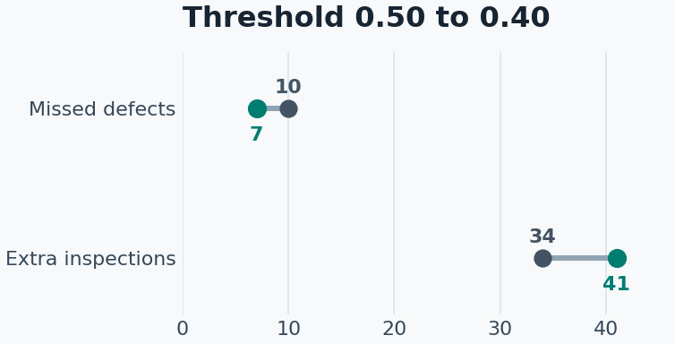
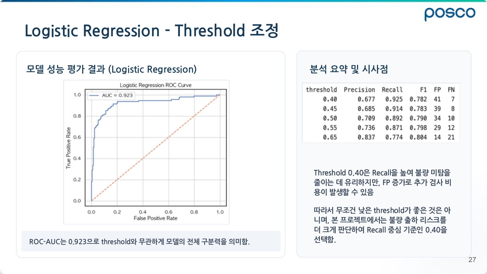
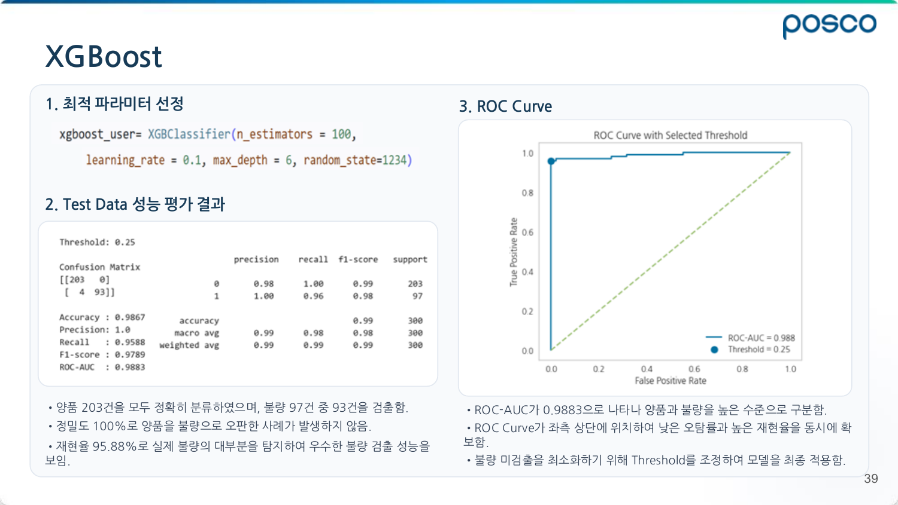
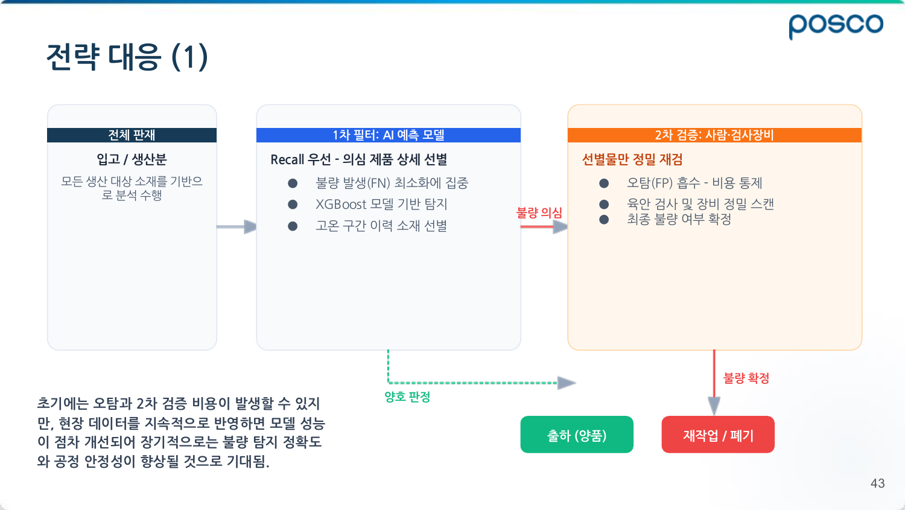

# POSCO 후판 Scale 불량 예측

> POSCO 청년 AI·Big Data 아카데미 5인 팀 프로젝트 · 공정 변수 탐색과 모델링 담당

## 목차

1. [문제와 담당 범위](#문제와-담당-범위)
1. [한 판재에서 어떤 정보를 읽었나](#한-판재에서-어떤-정보를-읽었나)
1. [작업 자료 구조](#작업-자료-구조)
1. [모델링 설계](#모델링-설계)
1. [평가 결과](#평가-결과)
1. [임계값을 바꿨을 때 검사 물량](#임계값을-바꿨을-때-검사-물량)
1. [검사 흐름 제안](#검사-흐름-제안)
1. [검증 범위와 재평가 방법](#검증-범위와-재평가-방법)
1. [팀 발표 자료](#팀-발표-자료)

## 문제와 담당 범위

가열·압연 과정에서 생기는 표면 산화층(Scale)이 후판에 남으면 품질 불량으로 이어질 수 있습니다. 교육용 공정 기록 1,000건에서 불량을 사전에 선별하고, 선별 결과를 정밀 검사 우선순위에 활용하는 방안을 검토했습니다.

저는 공정 데이터 탐색, 규격·작업 시간 파생변수 구성, VIF와 카이제곱 검정, 로지스틱 회귀 해석, 분류 모델과 판정 임계값 비교를 맡았습니다.

## 한 판재에서 어떤 정보를 읽었나

판재별 기록에는 제품 규격과 강종, 가열 및 압연 온도, 작업 시각, 디스케일링 조건 등이 있습니다. 이 정보를 입력으로 사용하고, 표면에 Scale 불량이 있었는지를 예측 대상으로 뒀습니다. 예를 들어 압연 온도는 공정상 중요한 값이지만, 0°C 기록은 센서 오류 후보로 따로 처리해야 했습니다.

규격 종류가 많아 개별 코드만 비교하기 어려웠습니다. 사용 목적이 비슷한 규격을 묶고, 작업 시각에서 주야간을 나누어 조건별 불량 분포를 탐색했습니다. 이 단계에서 관찰한 관계는 모델 변수나 점검 가설의 근거로 사용했습니다.

개별 판재에 점수를 매기기까지는 먼저 생산 기록에서 제품군과 작업 조건을 읽고, 변수마다 값이 어떤 경로로 기록됐는지 확인했습니다. 예를 들어 압연 온도 0°C를 그대로 두면 연속형 변수의 온도 분포와 모델 계수에 영향을 줄 수 있습니다. 규격·국가별 평균을 쓰는 방식은 비슷한 기록에서 값을 채우려는 선택이었습니다. 재검증에서는 보정 전·후의 분포를 비교하고, 0°C 기록의 비율이나 그룹별 표본이 작을 때의 처리도 함께 확인할 수 있습니다.

## 작업 자료 구조

```text
후판 공정 분석
├── EDA 노트북            규격·온도 분포, 0°C 센서 기록, HSB 조건 확인
├── 기다슬_로지스틱.ipynb  VIF, 범주형 변수 검정, 오즈비와 혼동행렬
├── 기다슬_모델링.ipynb    분류 모델 비교와 임계값 탐색
└── 팀 발표 자료           팀 XGBoost 평가와 검사 우선순위 제안
```

한 공정 기록에서 먼저 규격과 온도 정보를 정리합니다. 로지스틱 회귀는 불량과 연관된 변수의 방향을 해석하는 데 쓰고, 분류 모델의 점수는 검사 대상을 선별하는 데 사용했습니다. 두 목적에 맞춰 결과표를 따로 읽을 수 있도록 구성했습니다.

## 모델링 설계

1. **전처리.** 압연 중 기록된 0°C는 센서 오류 후보로 보고 규격·국가가 같은 그룹의 유효 온도 평균으로 대체했습니다. 세부 규격을 용도별로 묶고, 작업 시각을 주간·야간으로 구분했습니다.
2. **변수 해석.** VIF로 치수와 온도 변수 간 정보 중복을 조사하고, 카이제곱 검정으로 규격군·강종 같은 범주형 변수와 불량의 관련성을 확인했습니다. 설명용 로지스틱 회귀는 수치형 표준화와 범주형 원-핫 인코딩을 파이프라인으로 묶고 클래스 가중치를 적용했습니다. 회귀계수의 지수값인 오즈비로 온도와 불량의 관계 방향을 해석했습니다.
3. **HSB 조건.** 데이터에서 HSB(고압수 디스케일링) 미적용 기록은 모두 불량이었지만, 적용 기록에도 불량이 있었습니다. 이 조건은 비규제 로지스틱 회귀 추정을 불안정하게 만들 수 있어 초기 실험에서는 독립 점검 규칙으로 검토했습니다. 아래 성능을 보고한 규제 로지스틱 모델에는 HSB 변수를 포함했습니다.
4. **선별 비용.** 로지스틱 회귀와 Decision Tree, Random Forest, Gradient Boosting, XGBoost를 비교했습니다. 검사 우선순위를 정할 때는 불량을 놓치는 비용과 양품을 추가 검사하는 비용을 함께 봤습니다.

로지스틱 회귀 결과를 읽을 때는 계수 방향이 어떤 처리 조건에서 계산됐는지 함께 봤습니다. 온도처럼 단위와 범위가 다른 수치 변수는 표준화했으므로, 같은 조건에서 온도가 표준편차 하나만큼 변할 때 불량 오즈가 어느 방향으로 바뀌는지를 해석할 수 있습니다. 이 관계는 공정 조건을 임의로 바꾸는 실험의 결과와는 다릅니다. XGBoost 같은 분류 후보는 변수 간 조합으로 불량 점수를 만들 수 있으므로, 최종적으로 어떤 판재를 추가 검사할지 판단하는 데 쓰였습니다.

## 평가 결과

개인 노트북에서는 70:30 층화 분할로 로지스틱 회귀의 임계값을 비교했습니다. 팀 발표의 XGBoost는 별도의 평가 구성에서 발표한 결과입니다.

| 평가 | 실제 불량 중 탐지 | 미탐(FN) | 오탐(FP) | 불량 재현율 | 정밀도 | ROC-AUC |
| --- | ---: | ---: | ---: | ---: | ---: | ---: |
| 개인 로지스틱 회귀, 임계값 0.50 | 83/93 | 10 | 34 | 89.25% | 70.94% | 0.9229 |
| 동일 모델, 임계값 0.40 | 86/93 | 7 | 41 | 92.47% | 67.72% | 0.9229 |
| 팀 발표 XGBoost 후보 | 93/97 | 4 | 0 | 95.88% | 100% | 0.9883 |

로지스틱 회귀에서 임계값을 0.50에서 0.40으로 낮추자 불량을 3건 더 찾았고 양품 추가 검사 후보는 7건 늘었습니다. ROC-AUC는 동일 모델의 점수 순위로 계산하므로 임계값만 바꿔도 그대로입니다. 로지스틱과 팀 XGBoost는 평가에 사용한 불량 건수가 달라 표의 수치를 동일 테스트셋 비교로 해석할 수 없습니다.

## 임계값을 바꿨을 때 검사 물량

모델이 확인 대상으로 표시한 판재는 실제 불량 탐지와 양품 오탐을 합한 수입니다. 판재 한 건이 추가 검사 한 번에 해당한다고 놓고 개인 로지스틱 회귀 결과를 검사 물량으로 환산했습니다.

| 개인 로지스틱 기준 | 검사 대상 | 검사에 포함된 실제 불량 | 검사에 포함된 양품 | 놓친 불량 |
| --- | ---: | ---: | ---: | ---: |
| 임계값 0.50 | 117건 | 83건 | 34건 | 10건 |
| 임계값 0.40 | 127건 | 86건 | 41건 | 7건 |
| 0.40으로 변경했을 때 | +10건 | +3건 | +7건 | −3건 |

이 평가에서 낮은 임계값을 선택하면 검사 한도가 10건 더 필요하고, 새로 검사하는 10건 중 3건이 불량입니다. 정밀도를 상대적으로 높게 유지할지, 검사량을 늘려 미탐을 줄일지는 이 차이와 현장에서 감당할 수 있는 물량을 함께 봐야 결정할 수 있습니다.



## 검사 흐름 제안

모델 점수로 정밀 검사 대상을 선별하고, 고온 이력과 HSB 미적용은 별도 점검 신호로 활용하는 운영안을 제안했습니다. 디스케일링 횟수처럼 여러 생산 조건과 연관된 변수의 중요도는 인과관계로 해석하기 어렵습니다.

1. 생산 기록으로 불량 가능성을 계산해 의심 판재를 찾습니다.
2. 의심 판재는 사람과 검사 장비로 추가 확인합니다.
3. 운영안을 평가할 때는 불량 미탐과 추가 검사량을 함께 기록합니다. 임계값 변경에 따른 검사 물량 증가를 확인할 수 있습니다.

## 검증 범위와 재평가 방법

근거는 개인 모델링·로지스틱 회귀 노트북의 혼동행렬과 임계값 비교표, 팀 발표의 XGBoost 성능표입니다. 교육 실험에서는 규격별 대체 평균을 분할 전에 계산했고 같은 홀드아웃에서 임계값을 탐색했습니다. 운영 성능을 평가하려면 대체 평균은 학습 세트에서만 추정하고, 임계값은 검증 세트에서 고른 뒤 별도의 시간순 테스트 세트에서 검증해야 합니다. 외부 데이터 검증과 공장 적용·비용 절감 측정은 수행하지 않았습니다.

## 팀 발표 자료

포스코 청년 AI·Big Data 아카데미 B3조 발표 「POSCO 후판공정 데이터 분석 및 품질 예측」에서 발췌했습니다.

<details>
<summary>로지스틱 회귀 임계값 조정 · 27쪽</summary>



오른쪽 표의 0.50과 0.40을 비교하면 미탐은 10건에서 7건으로 줄고 오탐은 34건에서 41건으로 늘어납니다.

</details>

<details>
<summary>팀 XGBoost 평가 · 39쪽</summary>



팀의 별도 교육용 평가에서 불량 97건 중 93건을 검출했고 양품 오탐은 0건이었습니다. 슬라이드의 XGBoost 임계값은 0.25입니다.

</details>

<details>
<summary>검사 흐름 제안 · 43쪽</summary>



모델로 1차 선별한 뒤 의심 제품을 사람과 검사 장비로 재확인하는 팀의 운영 제안입니다.

</details>

[프로필의 더 살펴볼 프로젝트로 돌아가기](../README.md#더-살펴볼-프로젝트)
